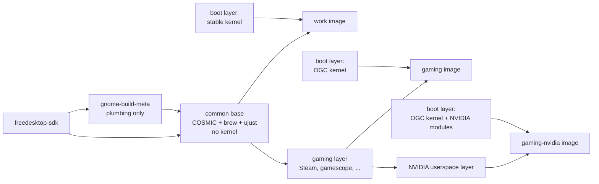

# COSMIC on a Dakota-style source-built base

Research notes and a proposed shape for a distroless, source-built bootc image
with the COSMIC desktop, modeled on Project Bluefin's **Dakota**. Nothing here
is built yet. This would live in its own repository; this repo builds Fedora-based
images with BlueBuild and is not the right tool for it (see
[Why not BlueBuild](#why-not-bluebuild)).

Research date: 2026-11-21. Version pins and status below go stale quickly.

## Goal

- One common COSMIC base, built once, with Homebrew and `ujust` everywhere.
- Three images:
  - **work**: base + the freedesktop-sdk stable kernel.
  - **gaming**: base + native Steam and a gaming stack + the OGC kernel.
  - **gaming-nvidia**: gaming + NVIDIA drivers built against the OGC kernel.
- No hardware-specific Bazzite extras (handheld, Steam Deck, laptop vendor tools)
  unless they come for free.
- The work image is security-hardened: mandatory access control enforced,
  Secure Boot, and related measures. Decided: AppArmor rather than SELinux,
  because AppArmor is what this base ships; see
  [Security hardening](#security-hardening-work-image).

## Research: how Dakota works

### What it is and its state

Dakota is "Bluefin built on GNOME OS, assembled entirely from source", published
as a bootc OCI image with no package manager in the image
([README](https://github.com/projectbluefin/dakota),
[Making Our Own Fate](https://docs.projectbluefin.io/blog/making-our-own-fate/)).

- Officially still alpha (Alpha 6 is the latest post; beta was targeted for the
  summer and GA for fall 2026, with no announcement of either yet). In practice
  dated `:stable` builds ship every couple of weeks; the latest is
  `stable-20261106` (kernel 7.3.1, GNOME 51.1, bootc 1.17.3).
- Images: `ghcr.io/projectbluefin/dakota`, `-nvidia`, `-gaming`,
  `-nvidia-gaming`, each with `:stable` and `:testing`.
- No rebase from Fedora-based images; install from the ISO
  ([dakota-iso](https://github.com/projectbluefin/dakota-iso), Tuna installer).
- systemd-boot, unified kernel images (UKIs), UEFI only, its own Secure Boot key.
  The docs contradict each other on whether Secure Boot is supported yet.

### The three BuildStream layers

| Layer | Project | What it contributes |
|---|---|---|
| Base "distro" | [freedesktop-sdk](https://gitlab.com/freedesktop-sdk/freedesktop-sdk) (pinned `26.08.4`) | Toolchain, glibc, core libs, Python, Rust, mesa, systemd, a stable kernel (`components/linux.bst`), firmware, Flatpak, image tooling (`vm/prepare-image.bst`, `components/oci-builder.bst`). Same project that produces the `org.freedesktop.Platform` Flatpak runtime. |
| GNOME OS | [gnome-build-meta](https://gitlab.gnome.org/GNOME/gnome-build-meta) (pinned to a `gnome-51` commit) | Rebuilds some fdsdk pieces from git (glib, GTK, systemd, Flatpak, portals), the GNOME desktop and apps, and OS plumbing: bootc, initramfs, signed modules, UKIs, OCI/bootc config (`oci/integration/bootc-config.bst`). |
| Dakota | [projectbluefin/dakota](https://github.com/projectbluefin/dakota) | Overrides plus the Bluefin layer, gaming, NVIDIA, and image assembly. |

Dakota pulls both upstreams in as BuildStream **junctions**
(`elements/freedesktop-sdk.bst`, `elements/gnome-build-meta.bst`) and swaps
individual elements with junction **overrides**. That is the equivalent of a
package manager's "replace this package", applied at build time. Examples from
Dakota:

- `components/linux.bst: core/linux-fdsdk.bst`, or `core/linux-ogc.bst` when the
  `gaming` project option is on. Because the swap happens at the junction
  boundary, every consumer (kernel modules, initramfs, NVIDIA modules) builds
  against the same kernel.
- `vm/mesa-default.bst: core/mesa-default.bst` (its own mesa).
- `gnomeos-deps/bootc.bst`, a newer bootc than GNOME ships.
- `core/meta-gnome-core-apps.bst` replaced with an empty set, because apps ship
  as Flatpaks.
- `oci/integration/os-release.bst` and the Plymouth theme replaced with Bluefin's.
- Module signing swapped to Dakota's key (`bluefin/signed-modules.bst`).

### Why building "everything from source" is affordable

`project.conf` lists two artifact caches: GNOME's (`gbm.gnome.org`) first, then
Bluefin's own (`cache.projectbluefin.io`). Every element's cache key is a hash
of its recipe and all its dependencies, so:

- anything Dakota does not change has the same key as GNOME's build and is
  downloaded prebuilt;
- anything Dakota changes, and everything that depends on it, is built once and
  pushed to Bluefin's cache.

Swapping a leaf (kernel, mesa, bootc) is cheap. Swapping something low in the
graph (glib, systemd) rebuilds most of the system.

### Image assembly

From [`docs/oci-assembly.md`](https://github.com/projectbluefin/dakota/blob/main/docs/oci-assembly.md):

- Each published image is a **base image plus one boot layer**. The base never
  contains kernel modules or depmod config (the build fails if it does). The
  boot layer holds the kernel, modules, initramfs and Secure Boot pieces.
- Because the base doesn't depend on the signing option, CI builds it once and
  the signing pass pulls it from the cache instead of rebuilding it.
- The NVIDIA image is built on top of the default base image
  (`oci/bluefin-nvidia-base.bst` takes `oci/bluefin-base.bst` as its parent), then
  gets its own boot layer.
- Images are rechunked with chunkah into roughly 120 layers for smaller updates.
- CI runs one job per `gaming` value, each building the default and NVIDIA images
  together (`.github/workflows/build.yml`, `publish.yml`).

### Where the pieces we want come from

| Want | Dakota element(s) | Source |
|---|---|---|
| Homebrew | `bluefin/brew.bst`, `bluefin/brew-tarball.bst`, `bluefin/sudo-linuxbrew-path.bst` | [ublue-os/brew](https://github.com/ublue-os/brew) `system_files/` |
| `just` / `ujust` | `freedesktop-sdk-extra.bst:components/just.bst` (via gnome-build-meta), `bluefin/common.bst`, `bluefin/just-overrides.bst` | [projectbluefin/common](https://github.com/projectbluefin/common) plus Dakota's `files/just-overrides/` |
| Gaming host stack | `gaming/host-platform.bst`, exposed for downstreams as `gaming/public-stacks/gaming-core.bst` | Mostly fdsdk components plus a few Dakota elements |
| Gaming Flatpak preinstalls | `gaming/flatpak-apps.bst` (`files/oci/gaming-flatpak/preinstall.d/`) | Flathub |
| OGC kernel | `core/linux-ogc.bst` | [OpenGamingCollective](https://github.com/OpenGamingCollective) |
| NVIDIA | `bluefin-nvidia/*` | NVIDIA `.run` installer, open kernel modules |

`gaming-core.bst` is explicitly meant for downstreams: "Downstreams that want to
choose their own app delivery can depend on this for native
Steam/gamescope, GameMode, controller rules/data, Vulkan discovery ... without
inheriting Dakota's non-Steam Flathub preinstall choices."

## What changes when the desktop is COSMIC

### Don't take GNOME OS's top-level stack

Dakota depends on `gnome-build-meta.bst:gnomeos-deps/deps.bst`, which pulls in
`core/meta-gnome-core-shell.bst` and `core/meta-gnome-core-apps.bst` along with the
OS services. A COSMIC build should not depend on that stack. Instead, depend
directly on the GNOME-free pieces:

- OS services and config: `core/meta-gnome-core-os-services.bst` (audit it first),
  `core/systemd-presets.bst`, the `gnomeos-deps/*-config.bst` elements,
  `gnomeos-deps/ntsync.bst`, `gnomeos-deps/flathub-config.bst`, `alsa-ucm-conf`,
  `fprintd`.
- Plumbing: `core-deps/systemd*.bst`, `core-deps/flatpak.bst`,
  `core-deps/xdg-desktop-portal*.bst` (the base portal plus `-gtk`; skip `-gnome`),
  `core-deps/NetworkManager.bst`, `core-deps/upower.bst`,
  `core-deps/power-profiles-daemon.bst`, `core/gvfs-daemon.bst`.
- Boot and image: `gnomeos-deps/bootc.bst`, `oci/integration/bootc-config.bst`,
  `oci/initramfs/*`, `core-deps/systemd-ukify.bst`.
- Skip: `core/gdm.bst` (replaced by greetd plus cosmic-greeter), the GNOME shell,
  mutter, `gnome-mimeapps`, and the GNOME Plymouth theme.

### COSMIC elements to write

These are the 28 packages Fedora 45's `cosmic-desktop` and `cosmic-desktop-apps`
groups installed in the `glos-bill` build (COSMIC 1.11.0). Each becomes a
BuildStream element; most are Rust crates from
[pop-os](https://github.com/pop-os) and build with the `cargo2` and
`gen_cargo_lock` source plugins Dakota already enables.

- **Session and shell:** `cosmic-session`, `cosmic-comp`, `cosmic-panel`,
  `cosmic-applets`, `cosmic-bg`, `cosmic-launcher`, `cosmic-app-library`,
  `cosmic-notifications`, `cosmic-osd`, `cosmic-osk`, `cosmic-idle`,
  `cosmic-workspaces`, `cosmic-settings-daemon`, `cosmic-randr`,
  `cosmic-screenshot`, `xdg-desktop-portal-cosmic`.
- **Login:** `cosmic-greeter` (runs as
  `greetd --config /etc/greetd/cosmic-greeter.toml`, with
  `Alias=display-manager.service`).
- **Apps:** `cosmic-settings`, `cosmic-files`, `cosmic-edit`, `cosmic-term`,
  `cosmic-store`, `cosmic-player`, `cosmic-initial-setup`.
- **Assets:** `cosmic-icon-theme`, `cosmic-wallpapers`.
- **Defaults:** our own replacement for Fedora's `cosmic-config-fedora` (default
  panel, theme and keybinding config), plus a `cosmic-mimeapps.list`.
- **Skip:** `cutecosmic-qt6`. Neither freedesktop-sdk nor GNOME OS ships Qt, and
  Qt apps come from Flatpak anyway.

Runtime dependencies from Fedora's packaging, checked against the two upstreams
by element name:

| Dependency | freedesktop-sdk | gnome-build-meta | Action |
|---|---|---|---|
| libseat, libinput, libdisplay-info, libxkbcommon, pixman, Xwayland | yes | some | reuse |
| PipeWire, WirePlumber, GStreamer (base, good, bad, libav) | yes | | reuse |
| polkit, NetworkManager, upower, BlueZ, iso-codes, xdg-user-dirs | yes | yes | reuse |
| power-profiles-daemon | | yes | reuse (instead of Fedora's `tuned-ppd`) |
| gvfs, fprintd, Flatpak | | yes | reuse |
| **greetd** | no | no | new element |
| **pop-launcher** (cosmic-launcher's backend) | no | no | new element (Rust) |
| **accountsservice** | not found by name | not found by name | verify, else new element |
| **nm-connection-editor** | no | no | new element, or rely on COSMIC Settings |
| adw-gtk3 theme, pop-icon-theme | no | no | new elements (assets) |

### Host apps or Flatpaks?

Dakota empties GNOME's core-apps set and preinstalls apps from Flathub. COSMIC
can go either way:

- **Host:** the session, shell, greeter, Settings and Files need host
  integration; build these as elements.
- **Flatpak candidates:** Edit, Term, Player and Store could be Flatpak
  preinstalls if COSMIC publishes them on Flathub or System76's COSMIC remote.
  That would cut the number of Rust elements we build and maintain. Check
  availability and update cadence first.

## Proposed shape

### Variants

| Image | Base | Extra layer | Kernel (boot layer) |
|---|---|---|---|
| `<name>` (work) | common base | none | freedesktop-sdk stable |
| `<name>-gaming` | common base | gaming | OGC |
| `<name>-gaming-nvidia` | common base | gaming + NVIDIA userspace | OGC + NVIDIA open modules |



### "Built once"

In BuildStream terms, "built once" means the base has one cache key across all
variants. Dakota gets there with two invariants, and we would add a third:

1. The base contains no kernel, kernel modules or depmod config (as in Dakota).
2. The base does not depend on the signing option (as in Dakota).
3. **New:** the base does not depend on the kernel choice. Dakota flips the
   kernel with a project option (`gaming`), which also adds the gaming stack to
   the base, so its base and gaming base differ. Here the gaming stack becomes a
   separate layer, and CI checks that `just bst show` reports the same base key
   with `-o gaming true` and `-o gaming false`.

The base OCI image is then assembled once. The gaming layer and boot layers are
appended with Dakota's `oci_append_layer.py` approach, the way Dakota already
appends its boot layer and builds the NVIDIA image on top of the default base.

Open question: whether a kernel option is still needed. NVIDIA modules
build-depend on `freedesktop-sdk.bst:components/linux.bst`, which resolves to
exactly one kernel per invocation. That's why Dakota uses a project option.
Keeping the option but confining its effect to the boot layer and the NVIDIA
modules is the simplest route.

### Repository layout (sketch)

```text
project.conf                 # junctions, caches (GNOME's first), plugins, options
elements/
  freedesktop-sdk.bst        # junction + overrides (kernel, mesa)
  gnome-build-meta.bst       # junction, plumbing only
  dakota.bst                 # optional junction, see "Copy or junction Dakota?"
  core/                      # linux-fdsdk, linux-ogc, mesa, os-release
  cosmic/                    # one element per COSMIC component + greetd,
                             # pop-launcher, defaults, mimeapps
  common/                    # brew, ujust, firstboot, flatpak preinstalls,
                             # plymouth theme, bootc install config
  gaming/                    # host stack, Steam, gamescope, sessions
  nvidia/                    # drivers, kargs, modprobe, container toolkit
  oci/
    base.bst                 # common base image (no kernel)
    layers/gaming.bst
    layers/nvidia.bst
    layers/boot-stable.bst
    layers/boot-ogc.bst
    layers/boot-ogc-nvidia.bst
    work.bst  gaming.bst  gaming-nvidia.bst
files/  patches/  scripts/  Justfile
.github/workflows/           # build, publish, track-sources, renovate
```

## Common to all images

- **Homebrew:** copy `bluefin/brew.bst`, `brew-tarball.bst` and
  `sudo-linuxbrew-path.bst` (from `ublue-os/brew`).
- **ujust:** `just` from `freedesktop-sdk-extra.bst:components/just.bst`, the
  `ujust` wrapper and shared recipes from `projectbluefin/common` (Dakota patches
  it; the GNOME-specific bits would need trimming), plus our own
  `/usr/share/ublue-os/just/*.just`.
- **Updates:** `bluefin/uupd.bst` (the Universal Blue auto-updater) and bootc.
- **First boot:** Dakota's `bluefin/firstboot-services.bst` and its Flatpak
  preinstall service (`/usr/share/flatpak/preinstall.d/`).
- **Containers and dev:** podman, skopeo, distrobox, git (Dakota's
  `bluefin/deps.bst` is a good checklist).

## Gaming layer

Taken from Dakota's `gaming/host-platform.bst`. Everything here is distro-neutral
or already in freedesktop-sdk.

| Item | Element | Take? |
|---|---|---|
| Native Steam launcher (Valve's `.deb` payload, versioned and sha-pinned) | `gaming/steam-native.bst` | yes |
| 32-bit Steam libraries | `gaming/steam-libs-i686*.bst`, fdsdk `cross-compilers/standard-libs-i686.bst` | yes (required by Steam) |
| GameMode daemon and library | fdsdk `gamemode-daemon`, `libgamemode` | yes |
| gamescope (OGC fork) | `gaming/gamescope.bst` | yes |
| Steam Big Picture session (OGC) | `gaming/gamescope-session.bst`, `gamescope-session-steam.bst` | yes; check that cosmic-greeter lists it as a session |
| MangoHud, vkBasalt | `gaming/mangohud.bst`, `vkbasalt.bst` | yes |
| Controller database and Steam Input udev rules | `gaming/sdl-gamecontrollerdb.bst` plus Steam's rules | yes |
| Vulkan loader links, SDL3/sdl2-compat, OpenAL, libpulse, ALSA plugins, X11 compatibility libs | fdsdk components | yes |
| ntsync module load | `core/ntsync-modules-load.bst` | yes |
| InputPlumber | `gaming/inputplumber.bst` | skip (handheld-specific) |
| Flatpak preinstalls: Lutris, Heroic, Bottles, ProtonPlus, Protontricks, GOverlay | `gaming/flatpak-apps.bst` | optional; this is a preference, not OS work |
| OGC kernel | `core/linux-ogc.bst` | yes (boot layer) |

## NVIDIA (gaming only)

- Copy `bluefin-nvidia/*`: drivers and open kernel modules from NVIDIA's `.run`
  installer, the VA-API driver, kernel arguments, modprobe config, device nodes,
  and the container toolkit.
- **Turing (GTX 16xx / RTX 20xx) or newer only.** Pascal and older need the
  closed kernel module, which Dakota does not ship.
- Modules build against the OGC kernel and must be signed with the same key as
  the kernel. They belong in the boot layer, never in the base.

## Security hardening (work image)

### Secure Boot: supported, copy Dakota

Dakota already has a full chain behind its `secure_boot_signing` option
(`bluefin/secure-boot.bst`, `files/secure-boot/dakota-secure-boot`):

```text
firmware (Microsoft keys)
  -> shimx64.efi     Fedora's Microsoft-signed shim, used byte-for-byte (bluefin/fedora-shim.bst)
  -> grubx64.efi     our systemd-boot, signed with our key (shim launches that name)
  -> signed kernel / UKI
  -> signed kernel modules (lockdown=integrity refuses unsigned ones)
```

- **Our key becomes trusted through MOK enrollment.** `dakota-secure-boot enroll`
  installs the chain on the ESP and queues the key; the user confirms it in
  MokManager on the next boot. No firmware key replacement is needed.
- **The pieces to copy:** `fedora-shim.bst` (pinned by checksum to a
  Bodhi-pushed Fedora build), `signed-efi.bst`, `signed-modules.bst`,
  `secure-boot-tools*.bst`, `lockdown-kargs.bst`, and the enroll, update,
  status and reseal script. gnome-build-meta supplies the signing plumbing
  (`gnomeos/signed-boot*.bst`, `fwupd-efi-signed*.bst`; fwupd needs the shim
  too).
- **The work image is the easy case:** no NVIDIA or other out-of-tree modules,
  so everything in the boot layer is ours to sign.
- **Keep the signing key in CI secrets only.** Dakota signs in a separate pass
  with no push remotes; the base image has the same cache key signed or
  unsigned, so it is reused.
- **Status caveat:** Dakota's README claims full Secure Boot support while its
  Alpha 6 post says it isn't supported yet. Treat it as working but young.

### Other hardening available from the same stack

| Measure | Where it comes from |
|---|---|
| Kernel lockdown (`lockdown=integrity`), kexec disabled | Dakota `bluefin/lockdown-kargs.bst`, `bluefin/kexec-disable.bst` |
| TPM2-bound disk unlock (LUKS), resealing after updates | systemd with `-Dtpm=true`, GNOME OS `pcrlock-config` and TPM2 initramfs module, Dakota's `reseal` |
| Audit framework | fdsdk `components/audit.bst`; systemd already builds against it |
| Memory-safe sudo | Dakota `bluefin/sudo-rs.bst` |
| Read-only, content-addressed `/usr` | bootc with composefs (Dakota ships composefs udev handling). Whether bootc's fs-verity sealing is usable yet needs checking. |
| App sandboxing | Flatpak by default, rootless podman |
| Mandatory access control | **AppArmor**, see below |

### SELinux: not available on this base

- **What the upstreams ship:** freedesktop-sdk has no SELinux libraries or
  policy at all (no libselinux, libsepol, libsemanage, policycoreutils or
  selinux-policy in `elements/components/`). It ships AppArmor instead
  (`apparmor.bst`, `libapparmor.bst`, `apparmor-profiles.bst`).
- **What GNOME OS uses:** gnome-build-meta builds systemd against AppArmor and
  audit, and ships an AppArmor kernel feature through sysupdate. So Dakota-style
  images can get mandatory access control from AppArmor, and only AppArmor,
  without forking the base. (Not yet checked: whether Dakota turns AppArmor on
  in its kernel arguments and loads profiles.)

Adding SELinux would mean:

1. **Package the userspace:** libsepol, libselinux, libsemanage, checkpolicy,
   policycoreutils and setools.
2. **Rebuild core components with SELinux enabled:** systemd, dbus, util-linux,
   PAM, shadow, coreutils (Dakota uses uutils, whose SELinux support would need
   checking), crun or podman, openssh, sudo, bootc and composefs. These sit
   low in the graph, so most of the system stops matching GNOME's cache and has
   to be built by us, every update.
3. **Write a policy:** Fedora's policy assumes Fedora's paths and packaging, and
   refpolicy needs adapting to this layout and to COSMIC, greetd, Flatpak and
   bootc.
4. **Label at build time:** BuildStream writes plain files, so the image must be
   labeled when it is assembled, and bootc and composefs must keep the labels
   through updates.

That is a distro-sized job with no upstream to share it with.

### Decision: AppArmor (option A)

Decided 2026-11-21: SELinux isn't a hard requirement, so the work image uses
AppArmor and keeps the single-base design. Background on why both are
acceptable:

- **Both are Linux Security Modules** providing mandatory access control.
  Neither is the universal standard: SELinux is the default on Fedora, RHEL and
  CentOS (and so on Universal Blue's Fedora images), and openSUSE moved new
  installs to it recently. AppArmor is the default on Ubuntu and Debian, and
  it's what GNOME OS and freedesktop-sdk use.
- **SELinux** labels every file and process and confines the whole system by
  type. It's finer-grained, but its policy is harder to write.
- **AppArmor** uses per-program, path-based profiles. It's simpler, but only
  programs with a profile are confined; everything else runs unconfined.

What option A requires of the work image:

1. **Enable AppArmor:** build the kernel with AppArmor enabled, set it in the
   kernel arguments (`lsm=...,apparmor` through `/usr/lib/bootc/kargs.d/`), and
   enable `apparmor.service` so profiles load at boot.
2. **Ship profiles:** start from freedesktop-sdk's `apparmor-profiles.bst`,
   then add or verify profiles for the exposed services: greetd and
   cosmic-greeter, NetworkManager, CUPS if shipped, sshd, podman/crun, and
   Flatpak (bubblewrap).
3. **Enforce, don't complain:** profiles in enforce mode in the work image, with
   a check in CI or at boot (`aa-status`) that fails if expected profiles aren't
   loaded and enforcing.
4. **Revisit coverage** as COSMIC components gain or lose profiles; anything
   unprofiled is unconfined.

The options that were considered:

| Option | MAC | Secure Boot | Fits "one base for all three" |
|---|---|---|---|
| A. Dakota-style base, AppArmor | AppArmor | Our key via MOK | Yes |
| B. Dakota-style base with SELinux added | SELinux | Our key via MOK | Yes, but we own an SELinux fork of freedesktop-sdk |
| C. Work image on Fedora COSMIC Atomic (bootc); gaming images Dakota-style | SELinux enforcing (Fedora's targeted policy) | Works out of the box: Fedora's Microsoft-signed shim and Fedora-signed kernel, no MOK | No: two bases, two build systems |

If SELinux ever becomes a hard requirement (for compliance, or a policy that
names it), option C is the fallback: the work image would come from this repo's
BlueBuild setup (`common-cosmic.yml` with the Fedora-only packages restored).

## Copy or junction Dakota?

- **Junction Dakota** for `gaming/public-stacks/gaming-core.bst`,
  `bluefin-nvidia/*` and the brew elements. This tracks their fixes for free,
  but ties our pins to theirs and risks dragging in GNOME through their
  dependencies.
- **Copy** the elements and keep a tracking workflow like Dakota's
  `track-bst-sources.yml`. This is independent, but every Steam, gamescope or
  NVIDIA bump is our job.

Suggested start: junction Dakota for `gaming-core` and NVIDIA, after confirming
with `bst show` that neither pulls in GNOME elements. Copy everything else.

## Infrastructure and costs

- **Artifact cache:** use GNOME's read-only cache, plus our own artifact and
  source cache server for anything we build. Dakota runs
  `cache.projectbluefin.io`; without one, every CI run rebuilds all COSMIC
  elements.
- **CI:** large Rust builds on GitHub runners; expect long first builds. Dakota
  caps its images at roughly 120 layers with chunkah.
- **Secure Boot:** a signing key for the kernel, modules, systemd-boot and
  fwupd, enrolled through MOK (machine owner key). Local builds stay unsigned.
- **Install:** an ISO and installer (fork `dakota-iso`). No rebase from this
  repo's Fedora images.
- **Upkeep:** COSMIC's Rust dependencies bump every release; Dakota's
  Renovate and `track-bst-sources` workflows are the model.

## Why not BlueBuild

BlueBuild modules assume a package manager (dnf, rpm-ostree). These images have
none, and their content is defined by the BuildStream graph, not by layering
onto a parent image. The COSMIC-on-Bazzite approach in `common-bazzite-cosmic.yml`
remains the low-effort option in this repo.

## Unverified and open questions

- accountsservice: not found by name in either upstream.
- Whether COSMIC apps are published on Flathub or System76's remote, and how
  often.
- Whether the OGC Steam session works from cosmic-greeter as-is.
- Whether `projectbluefin/common` and Dakota's `just-overrides` contain
  GNOME-only recipes that need removing.
- Secure Boot status in Dakota itself (README and Alpha 6 disagree).
- Whether Dakota enables AppArmor (kernel arguments, loaded profiles), and how
  much profile coverage freedesktop-sdk's `apparmor-profiles` gives a COSMIC
  desktop.
- Whether bootc's composefs fs-verity sealing is production-ready.
- Whether freedesktop-sdk's kernel config builds AppArmor in, or whether our
  kernel elements must enable it.
- Whether Dakota's `gaming-core` and NVIDIA stacks are free of GNOME dependencies
  (needed before junctioning them).

## Sources

- [projectbluefin/dakota](https://github.com/projectbluefin/dakota): README,
  `project.conf`, `elements/freedesktop-sdk.bst`, `elements/gnome-build-meta.bst`,
  `elements/gaming/*`, `elements/bluefin-nvidia/*`, `elements/oci/*`,
  `docs/oci-assembly.md`, `.github/workflows/build.yml`
- [Dakota releases](https://github.com/projectbluefin/dakota/releases)
- [Dakota Alpha 1](https://docs.projectbluefin.io/blog/dakota-alpha-1/),
  [Making Our Own Fate](https://docs.projectbluefin.io/blog/making-our-own-fate/),
  [Dakota blog tag](https://docs.projectbluefin.io/blog/tags/dakota/)
- [gnome-build-meta](https://gitlab.gnome.org/GNOME/gnome-build-meta) (`gnome-51`
  tree, `elements/gnomeos-deps/deps.bst`)
- [freedesktop-sdk](https://gitlab.com/freedesktop-sdk/freedesktop-sdk)
  (`release/26.08` `elements/components/`)
- COSMIC package list and dependencies: Fedora 45 packages in the `glos-bill`
  build, COSMIC 1.11.0
